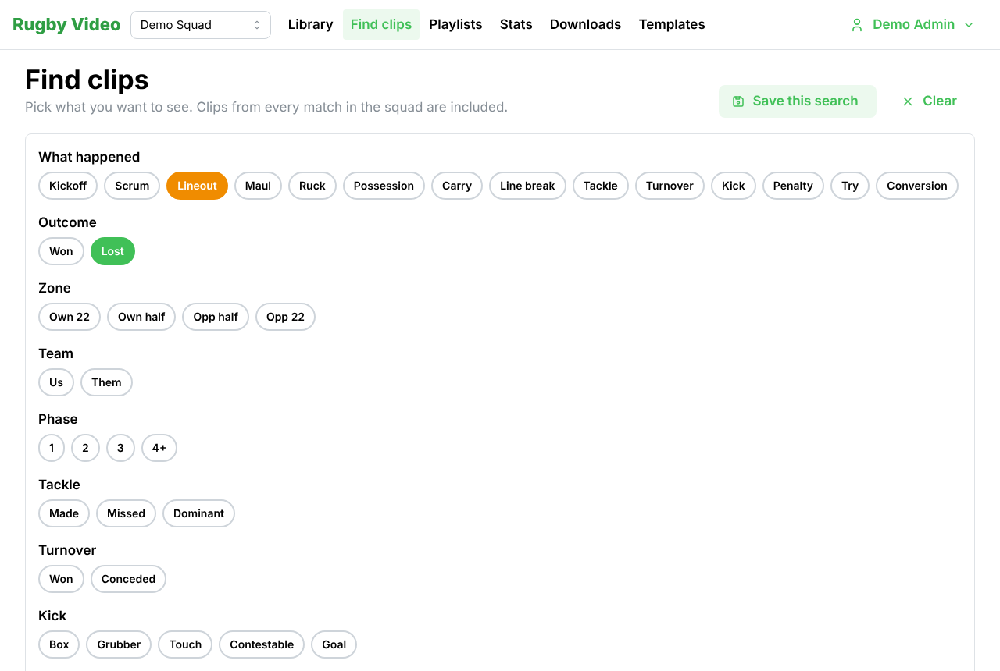
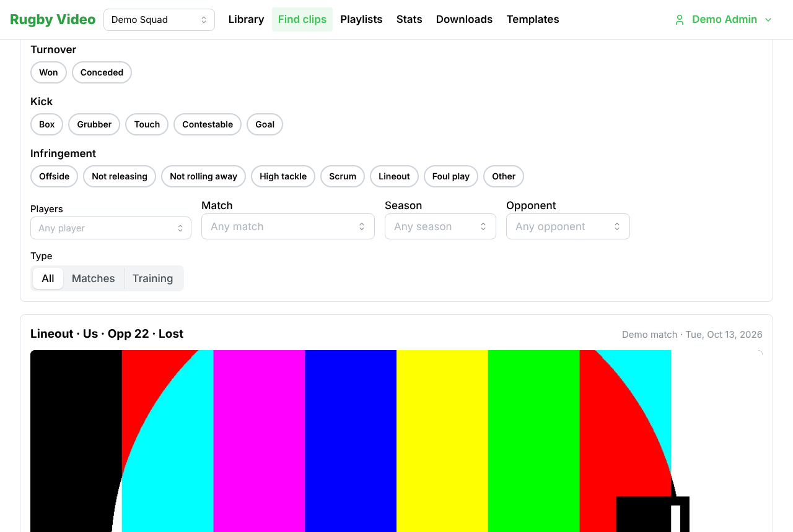
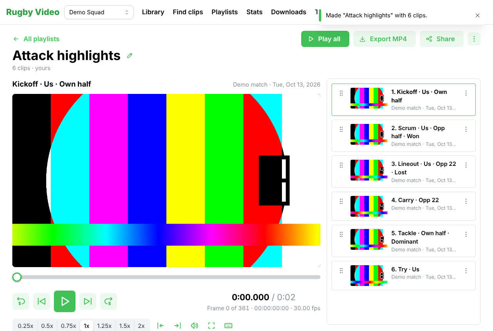
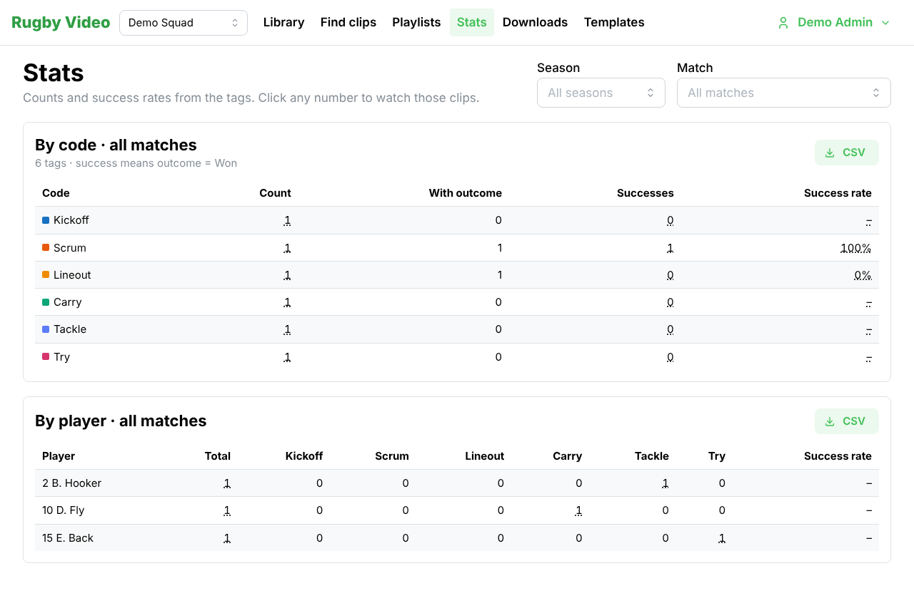
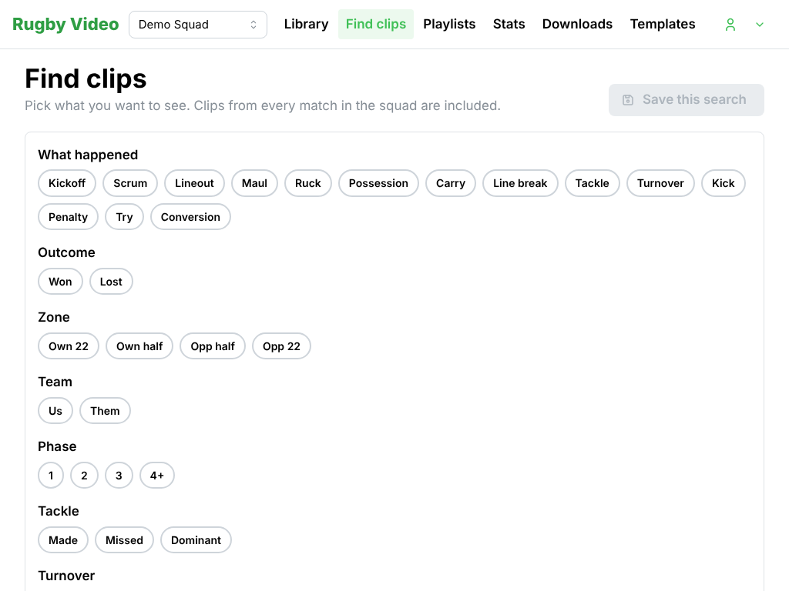

# Finding clips, playlists and stats

This guide is for coaches. You do not need to know how tagging works. If you can use a web
browser, you can do everything here with the mouse.

## Find clips

Press **Find clips** in the top bar.

1. Click the words that describe what you want to see. For example **Lineout** then **Lost**
   then **Opp 22** gives you every lineout we lost in their 22, from every match this squad has
   tagged. Click a word again to take it off. **Clear** starts again.
2. Narrow it down with **Players**, **Match**, **Season**, **Opponent** or **Type** if you
   want.
3. The clips appear below with a picture from the video. The number at the top tells you how
   many there are.

Click a clip to watch it. It plays just that moment and stops.

### Save a search you use often

Press **Save this search** and give it a name, for example "Our lineouts". Tick **Share with
everyone in the squad** if other staff should see it too. Saved searches appear in the box at
the top right; pick one to run it again.

## Playlists

A playlist is a set of clips you want to watch or share in one go.

- From **Find clips**, press **Save all as a playlist** to turn the current results into one.
  Or press **Add to playlist** under a clip you are watching to add just that one.
- Or go to **Playlists** and press **New playlist** to start an empty one.

In a playlist you can:

- Press **Play all**. Clips play one after another, even when they come from different
  matches. Use **Next** and **Previous** (or the **N** and **P** keys) to move around.
- **Drag** a clip by its handle to change the order.
- Open the menu on a clip (three dots) to **add a note** or **remove** it.
- **Rename** it with the pencil next to the title.
- **Share** it with other staff in the squad. They can watch it; only you (and the squad
  admin) can change it.
- **Duplicate** it, or **refresh** it if it was made from a search and new matches have
  been tagged since.
- **Export MP4** to get a single video file of all the clips, with the code and note shown on
  each clip if you like. Exports take a minute or two; find them under **Downloads**.

## Stats

Press **Stats** in the top bar. Pick a season or a match at the top right.

- The first table counts every code and shows the success rate where the template defines
  one (for example lineouts won out of lineouts with an outcome).
- The second table is per player: how many times each player was tagged, split by code.
- **Click any number** to watch those clips: the app makes a playlist for you and opens it.
- **CSV** downloads the table for a spreadsheet.

## On a tablet

Everything above works on an iPad or similar tablet in landscape or portrait. The clip list
sits under the video instead of beside it.

## If something looks wrong

- **No video yet** on a clip means the match video has not been uploaded. Ask the analyst.
- **Nothing matches yet** means no tags fit the words you picked. Try fewer words.
- If a page does not load, reload the browser and sign in again.
