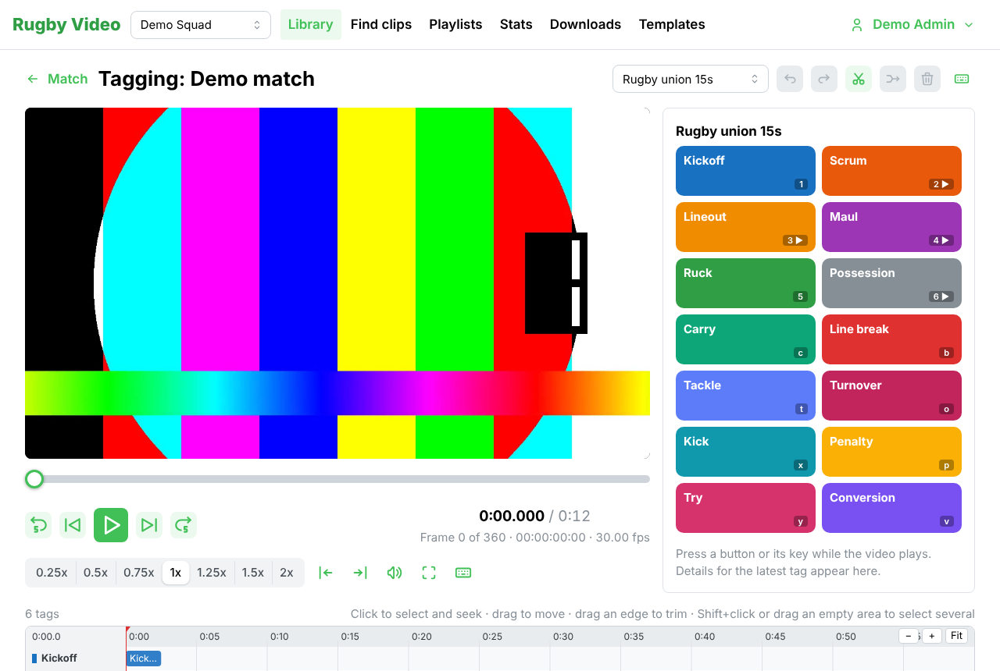
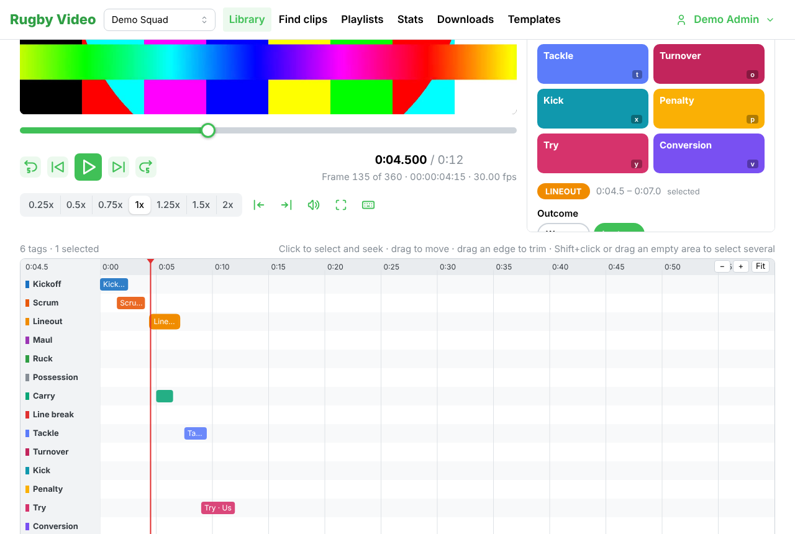

# Tagging a match

This guide is for whoever tags after a game: usually the analyst, sometimes a coach. It takes
about ten minutes to learn. Everything can be done with the mouse; the keys just make it
faster.

## Before you start

1. The match video must be uploaded and show **Ready** on the match page. If it is still
   processing, wait for the bar to finish.
2. Your squad needs a tag template. New squads get the rugby defaults ("Rugby union 15s" and
   "Rugby sevens"). An analyst can change the buttons under **Templates** in the top bar.

## Open the tagging screen

Open the match from the **Library** and press **Tag this match** (only analysts and admins
see this button).

The screen has three parts:

- **The video** (top left) with the usual controls: play/pause, frame back and forward, speed.
- **The code window** (top right): one big button per thing that can happen (Scrum, Lineout,
  Tackle...). The small label on each button is its key.
- **The timeline** (bottom): one row per code. Every tag you make appears here.

## Make tags

Play the video. When something happens, press its button or its key.

- **Instant codes** (Tackle, Carry, Kick, Try...) make a tag straight away. The tag starts a
  few seconds before you pressed and ends a few seconds after, so you do not have to be exact.
- **Start/stop codes** (Scrum, Lineout, Maul, Possession) record from the first press to the
  second. While one is recording its button pulses red and the tag grows on the timeline.
  Press the same button again to stop.

You do not need to pause. Keep the video playing and press keys as you go. A whole half of
rugby usually takes one pass.

## Add detail to a tag

Under the buttons you see the **latest tag** (or the one you have clicked on the timeline):

- Click **Won / Lost**, **Own 22 / Opp 22**, **Made / Missed** and so on. Click again to take
  it off. Keys: hold **Shift** and press the letter shown.
- **Players**: type a shirt number or a name and pick from the list.
- **Note**: type anything worth remembering. It is saved when you click away.

Detail goes on the latest tag unless you have selected another one.

## Fix a tag on the timeline

- **Click** a tag to select it. The video jumps to where it starts.
- **Drag** a tag to move it. Drag its left or right edge to change where it starts or ends.
  Edges snap to video frames.
- **Split**: select a tag, put the playhead where you want the cut (click in the time ruler or
  use the video controls) and press the scissors button, or **Alt + S**.
- **Merge**: select two or more tags with **Shift + click** (or drag a box around them) and
  press the join button, or **Alt + M**.
- **Delete**: select and press the bin button, **Delete** or **Backspace**.
- **Zoom**: use the + and − buttons on the timeline, or hold **Ctrl** (Cmd on a Mac) and
  scroll. Scroll normally to move along the match. **Fit** shows the whole match.

Made a mistake? **Undo** is the curved arrow at the top right, or **Cmd/Ctrl + Z**. Redo is
**Shift + Cmd/Ctrl + Z**. Every tagging and timeline action can be undone.

## Working with someone else

Changes save the moment you make them, so two people can tag the same match. If you both
change the same tag, the second person sees a short orange message and their screen shows the
other person's version. Nothing is lost silently.

## Keys at a glance

| Keys | What it does |
| --- | --- |
| Letter or digit on a button | Press that button |
| Shift + letter | Set that detail on the latest or selected tag |
| Space, K | Play / pause the video |
| J / L | Slower / faster |
| ← / → | One frame back / forward |
| Shift + ← / → | 5 seconds back / forward |
| Cmd/Ctrl + Z | Undo |
| Shift + Cmd/Ctrl + Z | Redo |
| Alt + S | Split the selected tag at the playhead |
| Alt + M | Merge the selected tags |
| Delete | Delete the selected tags |
| Esc | Clear the selection |

The keyboard icon at the top right of the screen shows this list at any time.
